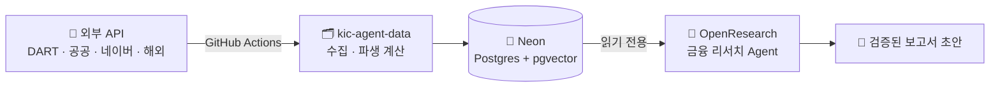

  

---

## 🔗 학습일지 & 프로젝트 LINK

> 💡 **KDT 기업맞춤형 AI-X 교육과정 (824시간)**

&nbsp;

&nbsp;

&nbsp;

---

## 🎨 Projects

### 🙋 개인 작업

<a href="https://github.com/chjogit/cardprofile">
  <picture>
    <source media="(prefers-color-scheme: dark)" srcset="https://github-stats-extended.vercel.app/api/pin/?username=chjogit&repo=cardprofile&theme=dark_github" />
    
  </picture>
</a>
<a href="https://github.com/chjogit/i2nutypo">
  <picture>
    <source media="(prefers-color-scheme: dark)" srcset="https://github-stats-extended.vercel.app/api/pin/?username=chjogit&repo=i2nutypo&theme=dark_github" />
    
  </picture>
</a>
<a href="https://github.com/chjogit/VOCALTUNER">
  <picture>
    <source media="(prefers-color-scheme: dark)" srcset="https://github-stats-extended.vercel.app/api/pin/?username=chjogit&repo=VOCALTUNER&theme=dark_github" />
    
  </picture>
</a>

> - **cardprofile** : 프로필 카드 생성 페이지
>   - 블록을 끌어다 놓고 꾸민 뒤 저장하면 `주소/아이디` 공개 페이지가 생기는 반응형 프로필 카드 빌더
>   - `Next.js` · `React` · `Tailwind CSS` · `Supabase` · `Vercel` &nbsp;|&nbsp; 🌐 [**Live Demo**](https://cardprofile-xi.vercel.app)
> - **i2nutypo** : 키네틱 타이포 영상 생성 페이지
>   - 음원과 가사로 키네틱 타이포그래피 영상을 만드는 웹 편집기 (입문 · 기본 · 숙련 3단계, 브라우저에서 모두 처리)
>   - `Django` · `TypeScript` · `React` · `Whisper` · `FFmpeg` · `Vercel`
> - **VOCALTUNER** : 보컬 음정·박자 보정 플러그인
>   - Studio One 등 ARA2 호스트에서 쓰는 VST3 플러그인. 블록·곡선 편집으로 음색을 유지한 채 음정·타이밍을 보정
>   - `C++` · `JUCE` · `ARA2` · `VST3` · `WORLD Vocoder` · `whisper.cpp` · `CMake` &nbsp;|&nbsp; ⬇️ [**Download**](https://github.com/chjogit/VOCALTUNER/releases/latest)

### 🚑 1차 프로젝트

<a href="https://github.com/aibbai/Project_911">
  <picture>
    <source media="(prefers-color-scheme: dark)" srcset="https://github-stats-extended.vercel.app/api/pin/?username=aibbai&repo=Project_911&theme=dark_github" />
    
  </picture>
</a>

> - **Project_911** : 응급의료 대응 최적화 프로젝트 (2026.09.28 ~ 2026.10.11, 2주)
>   - 서울시 자치구별 구급통계 · 생활인구 · 응급의료시설 데이터로 구급 수요를 분석하고, 미래 수요 예측과 실시간 응급실 가용병상 정보를 하나의 웹 서비스로 연계
>   - 자치구별 수요 분석 → 생활인구와의 관계 분석 → 수요 예측 모델 → 응급의료시설 · 실시간 병상 연계 → 웹 서비스
>   - 담당 : 웹 서비스 구현 및 배포 (지역 분석 · 수요 예측 · 실시간 병상 페이지)
>   - `Python` · `pandas` · `scikit-learn` · `TensorFlow` · `LightGBM` · `XGBoost` · `CatBoost` · `Flask` · `Bootstrap` · `Vercel`

### 👥 2차 프로젝트

<a href="https://github.com/chjogit/OpenResearch">
  <picture>
    <source media="(prefers-color-scheme: dark)" srcset="https://github-stats-extended.vercel.app/api/pin/?username=chjogit&repo=OpenResearch&theme=dark_github" />
    
  </picture>
</a>
<a href="https://github.com/chjogit/kic-agent-data">
  <picture>
    <source media="(prefers-color-scheme: dark)" srcset="https://github-stats-extended.vercel.app/api/pin/?username=chjogit&repo=kic-agent-data&theme=dark_github" />
    
  </picture>
</a>

> - **OpenResearch** (Agent) : 2차 프로젝트 에이전트 파트
>   - KIC AI Agent 공모전 4인 팀의 금융 리서치 AI Agent — 전문가 모드 / 가이드 모드 듀얼 출력, Verifier로 모든 수치 출처 대조
>   - `Python` · `LLM Agent` · `Neon (읽기 전용)`
> - **kic-agent-data** (Data) : 2차 프로젝트 데이터 파트
>   - 국내·해외 주식 데이터를 GitHub Actions로 자동 수집해 Neon(Postgres + pgvector)에 적재하는 파이프라인
>   - `Python` · `Neon` · `pgvector` · `GitHub Actions` · `Vercel`

---

## 🛠️ Tech Skills

> - Python 기반 데이터 분석 및 시각화
> - 머신러닝 / 딥러닝 모델링 (scikit-learn, TensorFlow)
> - LLM 활용 서비스 구현 (RAG, OpenAI API, Ollama, Langchain, HuggingFace, Fine-Tuning)

<!--
  색상 구성
  - Programming     : Python/pandas 공식색 + 블루 계열
  - DBMS            : 틸(청록) 계열
  - AI / ML         : 퍼플 → 핑크 그라데이션 (핵심 역량이라 가장 눈에 띄게)
  - WEB Standard    : 오렌지 → 앰버 계열
  - WEB Framework   : 그린 계열
  - Version Control : 슬레이트(회색) 계열
  - Deployment      : 스카이블루 계열
  ※ 마크다운 표는 한 행이 한 줄이어야 해서 배지를 공백으로 이어 붙임
  ※ 표 안에 주석을 넣으면 표가 깨지므로 주석은 여기에만 작성
-->

| 구분 | 기술 |
| :--- | :--- |
| **Programming** |      |
| **DBMS** |      |
| **AI / ML** |           -F43F5E?style=for-the-badge&logo=data%3Aimage%2Fsvg%2Bxml%3Bbase64%2CPHN2ZyB4bWxucz0iaHR0cDovL3d3dy53My5vcmcvMjAwMC9zdmciIHZpZXdCb3g9IjAgMCAyNCAyNCI%2BPHBhdGggZmlsbD0id2hpdGUiIGQ9Ik0zIDVoOXYySDN6bTE0IDBoNHYyaC00ek0xMiAzaDR2NmgtNHpNMyAxMWgzdjJIM3ptOCAwaDEwdjJIMTF6TTYgOWg0djZINnptLTMgOGgxMXYySDN6bTE2IDBoMnYyaC0yem0tNS0yaDR2NmgtNHoiLz48L3N2Zz4%3D) |
| **WEB Standard** |        |
| **WEB Framework** |       |
| **Version Control** |    |
| **Deployment** |     |

---

## 📊 GitHub Stats

<a href="https://github-stats-extended.vercel.app/api/top-langs?username=chjogit&layout=compact&langs_count=8&card_width=320">
  <picture>
    <source
      srcset="https://github-stats-extended.vercel.app/api/top-langs?username=chjogit&layout=compact&langs_count=8&card_width=320&theme=dark_github"
      media="(prefers-color-scheme: dark)"
    />
    
  </picture>
</a>

<a href="https://github-stats-extended.vercel.app/api?username=chjogit">
  <picture>
    <source
      srcset="https://github-stats-extended.vercel.app/api?username=chjogit&theme=dark_github"
      media="(prefers-color-scheme: dark)"
    />
    
  </picture>
</a>

 

  

